# Diagrama de clases UML — Haikyuu!! Market

Se renderiza automáticamente en GitHub (Mermaid). También se puede pegar en https://mermaid.live para exportarlo como PNG/SVG.

```mermaid
classDiagram
    direction TB

    %% ---------- Productos (herencia + abstracción + polimorfismo) ----------
    class Producto {
        <<abstract>>
        -string _id
        -string _nombre
        -string _descripcion
        -number _precioBase
        -Equipo _equipo
        -string _personaje
        -int _stock
        +categoria()* Categoria
        +etiquetaOpcion()* string
        #multiplicadores()* Record
        +detalle()* string
        +opciones() string[]
        +validarOpcion(opcion) string
        +precioUnitario(opcion) number
        +hayStock(cantidad) bool
        +descontarStock(cantidad) void
        +reponerStock(cantidad) void
    }
    class Figura {
        +int alturaCm
    }
    class Jersey {
        +int numero
    }
    class Poster {
        +string acabado
    }
    class Manga {
        +int tomo
    }
    Producto <|-- Figura
    Producto <|-- Jersey
    Producto <|-- Poster
    Producto <|-- Manga

    %% ---------- Catálogo y repositorios (DIP) ----------
    class RepositorioProductos {
        <<interface>>
        +listar() Producto[]
        +obtener(id) Producto
        +guardar(producto) void
    }
    class RepositorioProductosMemoria
    class RepositorioProductosSqlite {
        -BaseDatos db
        -Map~string, Producto~ cache
    }
    RepositorioProductos <|.. RepositorioProductosMemoria
    RepositorioProductos <|.. RepositorioProductosSqlite
    class Catalogo {
        -RepositorioProductos repo
        +obtener(id) Producto
        +consultar(filtro) Producto[]
        +categorias() Categoria[]
        +equipos() Equipo[]
    }
    Catalogo --> RepositorioProductos : usa
    RepositorioProductosMemoria o-- Producto
    RepositorioProductosSqlite o-- Producto

    %% ---------- Carrito (composición) ----------
    class Carrito {
        -Map~string, ItemCarrito~ _items
        -EstrategiaDescuento _descuento
        +agregar(producto, cantidad, opcion) ItemCarrito
        +eliminar(itemId) void
        +modificarCantidad(itemId, cantidad) ItemCarrito
        +cambiarOpcion(itemId, opcion) ItemCarrito
        +aplicarCupon(codigo) void
        +quitarCupon() void
        +vaciar() void
        +subtotal() number
        +descuento() number
        +total() number
    }
    class ItemCarrito {
        +string id
        -int _cantidad
        -string _opcion
        +precioUnitario() number
        +subtotal() number
        +cambiarCantidad(n) void
        +cambiarOpcion(opcion) void
    }
    class RepositorioCarritos {
        +obtenerOCrear(clienteId) Carrito
    }
    Carrito *-- "0..*" ItemCarrito : se compone de
    ItemCarrito --> "1" Producto : referencia
    RepositorioCarritos o-- Carrito

    %% ---------- Descuentos (Strategy) ----------
    class EstrategiaDescuento {
        <<interface>>
        +codigo string
        +descripcion string
        +calcular(subtotal) number
    }
    class SinDescuento
    class DescuentoPorcentaje {
        -number porcentaje
    }
    class DescuentoMontoFijo {
        -number monto
    }
    class FabricaDescuentos {
        +porCodigo(codigo)$ EstrategiaDescuento
    }
    EstrategiaDescuento <|.. SinDescuento
    EstrategiaDescuento <|.. DescuentoPorcentaje
    EstrategiaDescuento <|.. DescuentoMontoFijo
    Carrito --> EstrategiaDescuento : aplica
    FabricaDescuentos ..> EstrategiaDescuento : crea

    %% ---------- Pagos simulados (polimorfismo) ----------
    class MetodoPago {
        <<interface>>
        +nombre string
        +procesar(monto) ResultadoPago
    }
    class PagoTarjeta {
        -string numero
    }
    class PagoTransferencia
    class PagoEfectivo
    class FabricaPagos {
        +crear(tipo, datos)$ MetodoPago
    }
    MetodoPago <|.. PagoTarjeta
    MetodoPago <|.. PagoTransferencia
    MetodoPago <|.. PagoEfectivo
    FabricaPagos ..> MetodoPago : crea

    %% ---------- Compra y órdenes ----------
    class ServicioCompra {
        -RepositorioOrdenes ordenes
        -RepositorioProductos productos
        +comprar(clienteId, carrito, metodo) Orden
    }
    class Orden {
        <<inmutable>>
        +string id
        +string clienteId
        +LineaOrden[] lineas
        +number subtotal
        +number descuento
        +number total
        +string metodoPago
        +string referenciaPago
        +EstadoOrden estado
        +Date fecha
    }
    class LineaOrden {
        <<snapshot>>
        +string productoId
        +string nombre
        +string opcion
        +int cantidad
        +number precioUnitario
        +number subtotal
    }
    class RepositorioOrdenes {
        <<interface>>
        +guardar(orden) void
        +porCliente(clienteId) Orden[]
    }
    class RepositorioOrdenesMemoria
    class RepositorioOrdenesSqlite {
        -BaseDatos db
    }
    RepositorioOrdenes <|.. RepositorioOrdenesMemoria
    RepositorioOrdenes <|.. RepositorioOrdenesSqlite
    ServicioCompra --> Carrito : lee y vacía
    ServicioCompra --> MetodoPago : cobra con
    ServicioCompra --> RepositorioOrdenes : guarda en
    ServicioCompra --> RepositorioProductos : persiste stock en
    ServicioCompra ..> Orden : crea
    Orden *-- "1..*" LineaOrden

    %% ---------- Errores ----------
    class ErrorDominio {
        +int status
    }
    class StockInsuficienteError
    class PagoRechazadoError
    class OpcionInvalidaError
    class CuponInvalidoError
    class ProductoNoEncontradoError
    class ItemNoEncontradoError
    class CantidadInvalidaError
    class CarritoVacioError
    ErrorDominio <|-- StockInsuficienteError
    ErrorDominio <|-- PagoRechazadoError
    ErrorDominio <|-- OpcionInvalidaError
    ErrorDominio <|-- CuponInvalidoError
    ErrorDominio <|-- ProductoNoEncontradoError
    ErrorDominio <|-- ItemNoEncontradoError
    ErrorDominio <|-- CantidadInvalidaError
    ErrorDominio <|-- CarritoVacioError
```

## Responsabilidades

| Clase | Responsabilidad |
|---|---|
| `Producto` (abstracta) | Datos comunes, stock y cálculo de precio por opción. Cada subclase define sus opciones y multiplicadores. |
| `Figura`, `Jersey`, `Poster`, `Manga` | Tipos concretos de producto con sus propias opciones (edición, talla, tamaño, encuadernación). |
| `Catalogo` | Consultar, buscar (texto sin acentos) y filtrar (categoría, equipo, precio). |
| `Carrito` | Agregar, eliminar, modificar cantidad/opción, aplicar cupón, calcular subtotal, descuento y total. |
| `ItemCarrito` | Una línea del carrito; valida cantidad y stock; calcula su subtotal. |
| `EstrategiaDescuento` y derivadas | Calcular el descuento de un cupón (Strategy). `FabricaDescuentos` los crea por código. |
| `MetodoPago` y derivadas | Simular el cobro. Tarjeta aprueba/rechaza; transferencia y efectivo dejan el pago pendiente. |
| `ServicioCompra` | Checkout: revalida stock, cobra, descuenta inventario, crea la `Orden` y vacía el carrito. |
| `Orden` / `LineaOrden` | Registro inmutable de la compra (copia de precios al momento de comprar). |
| `Repositorio*` | Acceso a datos tras interfaces. La app usa las versiones `Sqlite` (productos, stock y órdenes quedan guardados en un archivo); las versiones `Memoria` se usan en las pruebas. Cambiar de motor no toca el dominio. |

## Conceptos de POO aplicados

- **Encapsulamiento:** `Producto` guarda precio y stock como privados (solo cambia con `descontarStock`/`reponerStock`); `Carrito` e `ItemCarrito` protegen sus colecciones y validan cada cambio.
- **Herencia:** `Figura`, `Jersey`, `Poster` y `Manga` extienden `Producto`; los errores extienden `ErrorDominio`.
- **Polimorfismo:** el `Carrito` llama `precioUnitario()` sin saber el tipo de producto; `ServicioCompra` llama `procesar()` sin saber el método de pago.
- **Abstracción:** `Producto` (clase abstracta) e interfaces `MetodoPago`, `EstrategiaDescuento`, `Repositorio*`.
- **Composición:** `Carrito` *se compone de* `ItemCarrito`; `Orden` *se compone de* `LineaOrden`.
- **SOLID:**
  - *S* — cada clase tiene una sola responsabilidad (carrito calcula, servicio cobra, repositorio guarda).
  - *O* — un nuevo producto, cupón o método de pago se agrega con una clase nueva, sin modificar las existentes.
  - *L* — cualquier subclase de `Producto` se puede usar donde se espera un `Producto`.
  - *I* — interfaces pequeñas (`MetodoPago` tiene un solo método).
  - *D* — `Catalogo` y `ServicioCompra` dependen de interfaces de repositorio, no de implementaciones.
